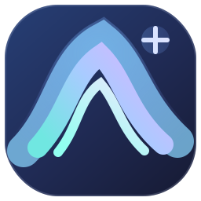

# Aurora

<p align="center">
  
</p>

<p align="center"><strong>A privacy-minded desktop browser experiment for Windows</strong></p>

<p align="center">
  <a href="#русский">Русский</a> ·
  <a href="#english">English</a> ·
  <a href="#简体中文">简体中文</a>
</p>

Aurora is an early-stage browser project. It currently contains a more feature-complete Python/Qt WebEngine application and a newer Rust/Wry browser prototype backed by Microsoft Edge WebView2. The Rust app uses the Chromium-based WebView2 engine installed on Windows; it does not build or bundle the Chromium source tree.

> **Status:** Experimental alpha. Aurora has not undergone a security audit and is not a hardened privacy browser. Do not rely on it for sensitive browsing.

---

## Русский

Aurora — экспериментальный настольный браузер для Windows с упором на приватность и прозрачное описание ограничений. В репозитории находятся две версии: более функциональный прототип на Python и Qt WebEngine и новая версия на Rust и Wry с движком Microsoft Edge WebView2.

### Возможности

**Python-приложение (`app/`)**

- Вкладки, адресная строка и поиск, навигация назад/вперёд и обновление страницы.
- Профиль Chromium на базе Qt WebEngine, закладки и список недавно посещённых страниц.
- Приватное окно с непостоянными cookies и кэшем в памяти. Скачанные пользователем файлы сохраняются отдельно.
- Запросы разрешений сайтов, включая камеру, микрофон, геолокацию и уведомления.
- Базовая фильтрация известных трекер-доменов через движок Brave Adblock.
- Дополнительные профили с паролем и шифрованием закладок и журнала Aurora. Данные Qt WebEngine, такие как cookies, кэш и собственная история Chromium, этим механизмом не шифруются.
- Диалог выбора места сохранения загрузок.

**Rust-прототип (`rust-browser/`)**

- Окно браузера на Rust, Wry и установленном WebView2 Runtime.
- Вкладки, адресная строка, поиск, переходы назад и вперёд, обновление и закладки.
- Список посещений, очистка журнала, загрузки в папку Downloads.
- Страница новой вкладки Aurora, меню библиотеки и настройки темы, поисковика, стартовой страницы и анимаций.
- Логотип Aurora и Windows-иконка приложения.

Rust-версия пока не поддерживает все функции Python-прототипа: в частности, приватные окна, управление разрешениями, блокировку трекеров, защищённые профили и диалог выбора места загрузки. Хранение данных WebView2 не зашифровано.

### Запуск Python-версии

Текущая инструкция сборки Windows проверена с 64-разрядным Python 3.13.

```powershell
py -3.13 -m venv .venv
.\.venv\Scripts\Activate.ps1
python -m pip install -r requirements.txt
python app\main.py
```

По умолчанию профиль Qt WebEngine находится в `%LOCALAPPDATA%\Aurora\Default`. Для защищённого профиля Aurora показывает ключ восстановления при создании — сохраните его отдельно.

### Запуск Rust-версии

Требуются Rust stable, Visual Studio Build Tools с компонентом **Desktop development with C++**, Windows SDK и Microsoft Edge WebView2 Runtime.

```powershell
cd rust-browser
cargo run
```

Профиль Rust-версии хранится в `%LOCALAPPDATA%\Aurora\Rust\Default`. Сборка в релизном режиме: `cargo build --release`.

### Сборка Python-версии для Windows

Из корня репозитория выполните:

```powershell
.\packaging\build-windows.ps1
```

Скрипт создаёт переносимую папку `dist\Nuitka\main.dist`. Это не установщик; для запуска нужно сохранять всю папку целиком. Rust-версия собирается Cargo и использует WebView2 Runtime, установленный в системе.

### Приватность и безопасность

Приватный режим ограничивает локальное сохранение данных браузером, но не скрывает сетевую активность от сайтов, провайдера или администратора сети. Шифрование дополнительных Python-профилей относится только к данным Aurora, перечисленным выше; файлы профиля самого Chromium остаются открытыми на диске. Обычный профиль также не зашифрован.

Qt WebEngine и WebView2 поставляются и обновляются отдельно от Aurora. В проекте нет собственного конвейера обновлений браузерного движка, цифровой подписи релизов или синхронизации аккаунта. Полный список ограничений и модель угроз: [`docs/threat-model.md`](docs/threat-model.md), [`docs/profile-crypto.md`](docs/profile-crypto.md) и [`docs/architecture.md`](docs/architecture.md). Использованные внешние проекты и лицензии перечислены в [`docs/third-party-sources.md`](docs/third-party-sources.md).

### Структура репозитория

| Путь | Содержимое |
| --- | --- |
| `app/` | Python-приложение, UI и приватность |
| `rust-browser/` | Rust/Wry/WebView2-прототип, интерфейс и бренд-ресурсы |
| `docs/` | Архитектура, модель угроз, шифрование и сторонние проекты |
| `tests/` | Тесты Python-компонентов |
| `packaging/` | Скрипт сборки Windows Python-версии |
| `requirements.txt` | Зависимости Python |

### Лицензия

Исходный код Aurora распространяется по лицензии MIT. Лицензии сторонних зависимостей остаются в силе; см. [`LICENSE`](LICENSE) и [`docs/third-party-sources.md`](docs/third-party-sources.md).

---

## English

Aurora is an experimental Windows desktop browser project focused on privacy and clear documentation of its limitations. The repository contains two implementations: a more feature-complete Python/Qt WebEngine prototype and a newer Rust/Wry application using Microsoft Edge WebView2.

### Features

**Python application (`app/`)**

- Tabs, address/search bar, back and forward navigation, and reload.
- A Qt WebEngine Chromium profile, bookmarks, and a recent-visit list.
- Private windows with non-persistent cookies and in-memory cache. Files explicitly downloaded by the user are saved separately.
- Website permission prompts, including camera, microphone, location, and notifications.
- Basic filtering of a bundled set of tracker domains through Brave Adblock.
- Optional password-protected profiles that encrypt Aurora bookmarks and its own visit list. Qt WebEngine data such as cookies, cache, and Chromium's own history are not encrypted by this feature.
- A save-location dialog for downloads.

**Rust prototype (`rust-browser/`)**

- A Rust and Wry desktop shell using the installed WebView2 Runtime.
- Tabs, address/search bar, back/forward navigation, reload, and bookmarks.
- Visit list, history clearing, and downloads to the Downloads folder.
- Aurora new-tab page, library menu, and settings for theme, search provider, start page, and animations.
- Aurora logo and Windows application icon.

The Rust version has not yet caught up with the Python prototype. Private windows, website permission controls, tracker blocking, protected profiles, and a download-location prompt are not implemented there. WebView2 profile data is not encrypted.

### Run the Python version

The current Windows packaging workflow has been verified with 64-bit Python 3.13.

```powershell
py -3.13 -m venv .venv
.\.venv\Scripts\Activate.ps1
python -m pip install -r requirements.txt
python app\main.py
```

The default Qt WebEngine profile is stored under `%LOCALAPPDATA%\Aurora\Default`. Aurora displays a recovery key when you create a protected profile; store it separately.

### Run the Rust version

Requirements: stable Rust, Visual Studio Build Tools with **Desktop development with C++**, the Windows SDK, and Microsoft Edge WebView2 Runtime.

```powershell
cd rust-browser
cargo run
```

The Rust profile is stored under `%LOCALAPPDATA%\Aurora\Rust\Default`. Build an optimized executable with `cargo build --release`.

### Package the Python version on Windows

From the repository root, run:

```powershell
.\packaging\build-windows.ps1
```

The script creates a portable folder at `dist\Nuitka\main.dist`. This is not an installer; keep the entire folder together. The Rust application is built with Cargo and uses the system-installed WebView2 Runtime.

### Privacy and security

Private browsing limits local browser data persistence; it does not hide network activity from websites, an internet provider, or a network administrator. Encryption in optional Python profiles covers only the Aurora data described above; Chromium's own profile files remain unencrypted on disk. The regular profile is also unencrypted.

Qt WebEngine and WebView2 are distributed and updated separately from Aurora. The project does not provide its own browser-engine update channel, signed releases, or account sync. For details, see the [threat model](docs/threat-model.md), [profile encryption notes](docs/profile-crypto.md), and [architecture notes](docs/architecture.md). External projects and their licenses are listed in [third-party sources](docs/third-party-sources.md).

### Repository layout

| Path | Contents |
| --- | --- |
| `app/` | Python application, UI, and privacy code |
| `rust-browser/` | Rust/Wry/WebView2 prototype, UI, and brand assets |
| `docs/` | Architecture, threat model, profile encryption, and third-party sources |
| `tests/` | Tests for Python components |
| `packaging/` | Windows packaging script for the Python version |
| `requirements.txt` | Python dependencies |

### License

Aurora source code is distributed under the MIT License. Third-party dependencies retain their own licenses; see [`LICENSE`](LICENSE) and [`docs/third-party-sources.md`](docs/third-party-sources.md).

---

## 简体中文

Aurora 是一个面向 Windows 的实验性桌面浏览器项目，注重隐私并明确说明当前限制。本仓库包含两个实现：功能较完整的 Python/Qt WebEngine 原型，以及较新的 Rust/Wry 应用，后者使用 Microsoft Edge WebView2。

### 功能

**Python 应用（`app/`）**

- 多标签页、地址栏与搜索、前进、后退和刷新。
- 基于 Qt WebEngine 的 Chromium 配置文件、书签和最近访问记录。
- 隐身窗口使用非持久化 Cookie 和内存缓存；用户主动下载的文件会单独保存。
- 网站权限提示，包括摄像头、麦克风、位置和通知。
- 通过 Brave Adblock 引擎过滤一小组内置跟踪器域名。
- 可选的密码保护配置文件，用于加密 Aurora 书签和 Aurora 自身的访问记录。Qt WebEngine 的 Cookie、缓存和 Chromium 自带历史记录不会因此加密。
- 下载时可选择保存位置。

**Rust 原型（`rust-browser/`）**

- 使用 Rust 和 Wry 构建桌面窗口，并调用系统安装的 WebView2 Runtime。
- 多标签页、地址栏与搜索、前进/后退、刷新和书签。
- 访问记录、清除历史，以及下载到 Downloads 文件夹。
- Aurora 新标签页、资料库菜单，以及主题、搜索引擎、起始页和动画设置。
- Aurora 标志和 Windows 应用图标。

Rust 版本尚未实现 Python 原型的全部功能。目前不支持隐身窗口、网站权限管理、跟踪器拦截、受保护的配置文件和下载位置提示。WebView2 配置文件数据未加密。

### 运行 Python 版本

当前 Windows 打包流程已使用 64 位 Python 3.13 验证。

```powershell
py -3.13 -m venv .venv
.\.venv\Scripts\Activate.ps1
python -m pip install -r requirements.txt
python app\main.py
```

默认 Qt WebEngine 配置文件位于 `%LOCALAPPDATA%\Aurora\Default`。创建受密码保护的配置文件时，Aurora 会显示恢复密钥；请妥善单独保存。

### 运行 Rust 版本

需要 stable Rust、包含 **Desktop development with C++** 工作负载的 Visual Studio Build Tools、Windows SDK，以及 Microsoft Edge WebView2 Runtime。

```powershell
cd rust-browser
cargo run
```

Rust 版本的配置文件位于 `%LOCALAPPDATA%\Aurora\Rust\Default`。运行 `cargo build --release` 可生成优化后的程序。

### 在 Windows 上打包 Python 版本

在仓库根目录运行：

```powershell
.\packaging\build-windows.ps1
```

脚本会在 `dist\Nuitka\main.dist` 创建便携文件夹。这不是安装程序；运行时必须保留整个文件夹。Rust 应用由 Cargo 构建，并使用系统安装的 WebView2 Runtime。

### 隐私与安全

隐身浏览只限制浏览器在本地保存数据，并不能隐藏网站、互联网服务提供商或网络管理员可见的网络活动。Python 受保护配置文件的加密范围仅限于上述 Aurora 数据；Chromium 自身的配置文件文件仍以未加密形式保存在磁盘上。普通配置文件也未加密。

Qt WebEngine 和 WebView2 由 Aurora 以外的组件分发和更新。本项目目前没有自己的浏览器引擎更新渠道、签名发布流程或账户同步功能。详情请参阅[威胁模型](docs/threat-model.md)、[配置文件加密说明](docs/profile-crypto.md)和[架构说明](docs/architecture.md)。外部项目及其许可证列于[第三方来源](docs/third-party-sources.md)。

### 仓库结构

| 路径 | 内容 |
| --- | --- |
| `app/` | Python 应用、界面和隐私功能 |
| `rust-browser/` | Rust/Wry/WebView2 原型、界面和品牌资源 |
| `docs/` | 架构、威胁模型、配置文件加密和第三方来源 |
| `tests/` | Python 组件测试 |
| `packaging/` | Python 版本的 Windows 打包脚本 |
| `requirements.txt` | Python 依赖 |

### 许可证

Aurora 源代码采用 MIT 许可证。第三方依赖仍受各自许可证约束；请参阅 [`LICENSE`](LICENSE) 和 [`docs/third-party-sources.md`](docs/third-party-sources.md)。
